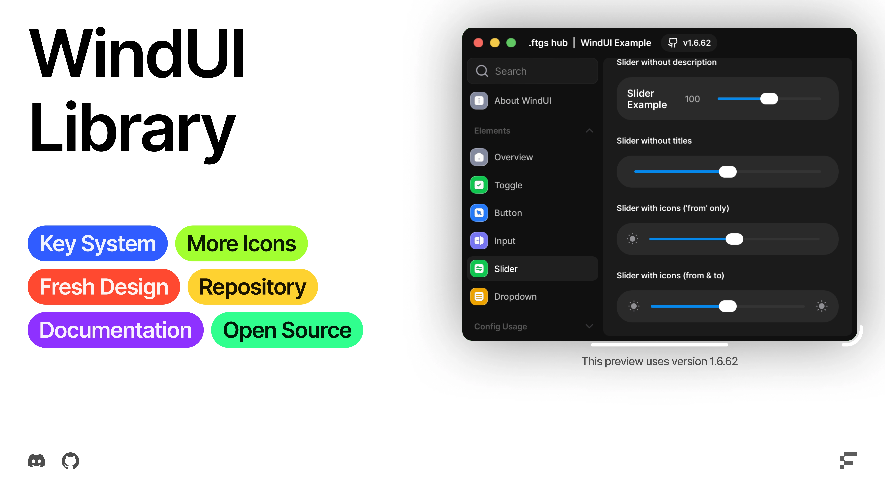

## Script Hub Remastered — emoboy723

WindUI modificado con fondo animado de flores, búsqueda en ScriptBlox, etiquetas,
filtros, favoritos, historial, editor y ajustes. Derivado de
[Footagesus/WindUI](https://github.com/Footagesus/WindUI); se conserva su licencia MIT.

Ejecuta este único script en tu executor:

```lua
loadstring(game:HttpGet("https://raw.githubusercontent.com/emoboy723/wind-ui-script-hub/main/loader.lua"))()
```

El cargador descarga `dist/script-hub.lua`, que incluye la librería y el sprite sheet
del GIF. Requiere acceso HTTP, `loadstring`, `writefile` y `getcustomasset` o
`getsynasset`. Favoritos y ajustes se guardan en el workspace local del executor.
No se ejecutan scripts del catálogo hasta pulsar Ejecutar.

[Guía y comprobaciones](docs/HubRemastered.md) · [Código completo](dist/script-hub.lua)

---

<!--<h1 align="center">WindUI</h1> -->

<!--
<picture>
    <source srcset="docs/banner-dark.webp" media="(prefers-color-scheme: dark)">
    <source srcset="docs/banner-light.webp" media="(prefers-color-scheme: light)">
    
</picture>-->


I might rewrite this project from scratch later.

> [!WARNING]
> This WindUI was not inspired by, and the name has nothing to do with UI Frameworks

> [!WARNING]
> WindUI is currently in Beta.
> This project is still under active development. Bugs, issues, and unstable features may occur. We’re constantly working on improvements, so please be patient and report any problems you encounter.

## Credits

#### Icons (https://github.com/Footagesus/Icons)

- [Lucide-Icons](https://github.com/lucide-icons/lucide)
- [Craft Icons](https://www.figma.com/community/file/1415718327120418204)
- [Geist Icons](https://vercel.com/geist/icons)
- [Solar Icons](https://icones.js.org/collection/solar)
- [SF Symbols](https://sf-symbols-one.vercel.app/)

### Links

- [Discord Server](https://discord.gg/ftgs-development-hub-1300692552005189632)
- [Documentation](https://footagesus.github.io/treehub-web/docs/windui)
- [Installation](https://footagesus.github.io/WindUI-Docs/docs/installation)
- [Example](/main_example.lua) (wip)
    ```luau
    loadstring(game:HttpGet('https://raw.githubusercontent.com/Footagesus/WindUI/refs/heads/main/main_example.lua'))()
    ```

## Animated window background

This modified source adds `GIFBackground` sprite-sheet playback inside the original
window background. See [API, demo instructions and verification limits](docs/GIFBackground.md),
[demo source](examples/GIFBackground.lua), and [Studio demo model](examples/WindUI-GIF-Demo.rbxm).

## Integrated script browser

Run [dist/script-hub.lua](dist/script-hub.lua) for the minimal hub with an animated
background and integrated ScriptBlox search, code preview, copy and execute buttons.
See [usage, verified catalog size and provider limits](docs/ScriptSearch.md).

The remastered hub adds Home, Explore, Favorites, History, Editor and Settings,
real metadata badges and server-side filters. The provider reported 74,252 records
in the live count check. See [the remastered hub guide and verification](docs/HubRemastered.md).
